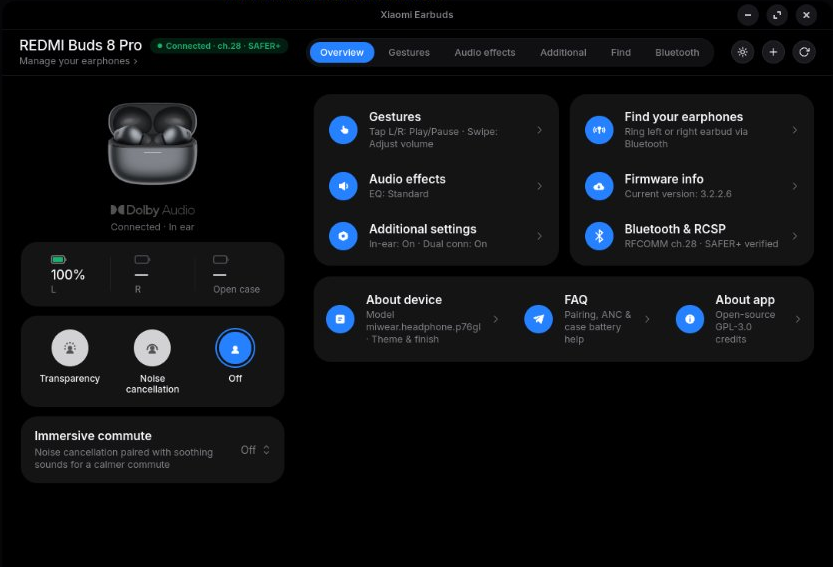
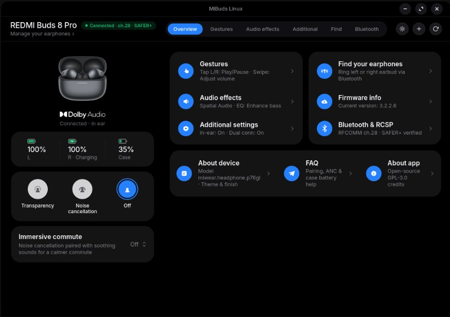
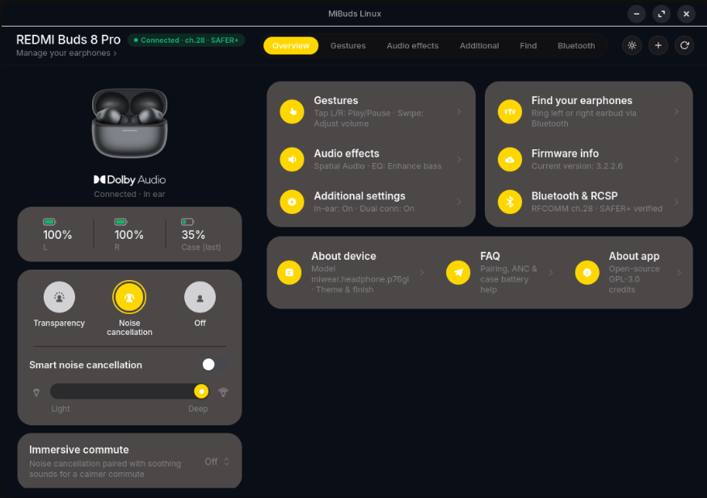

<div align="center">


# MiBuds Linux

**Unofficial open-source Linux desktop companion for Xiaomi and Redmi earbuds.**

A native GTK3 + WebKit2 desktop app inspired by the Xiaomi Earbuds mobile interface, built for **Ubuntu**, **Zorin OS**, and modern Linux desktops (Wayland & X11) over **BlueZ RFCOMM** with **SAFER+** authentication.

> **Pre-release (`v0.1.0-beta.1`):** Hardware-tested on **REDMI Buds 8 Pro** (firmware `3.2.2.6`). Other Xiaomi/Redmi models in the device catalog are detected dynamically, though feature compatibility may vary by model and firmware.

<br>



</div>

> **Disclaimer:** MiBuds Linux is an independent, unofficial community open-source project and is **not affiliated with, endorsed by, or sponsored by Xiaomi Inc., Redmi, or Dolby Laboratories**. All product names, logos, and imagery belong to their respective owners and are used purely for hardware identification and visual familiarity.

---

## Screenshots

| Live Charging & Case Battery | Custom Theme Support |
| :---: | :---: |
|  |  |

---

## Features

| Category | Capabilities |
| --- | --- |
| **Noise Control (ANC)** | Switch between **Transparency**, **Noise cancellation**, and **Off**; continuous 20-step ANC depth slider (`0–19`) + **Smart noise cancellation**; 3-step Transparency slider (*Regular*, *Enhance voice*, *Enhance ambient sound*). |
| **Immersive Commute** | Hardware Immersive Commute command (`0x004A`) paired with native Linux PipeWire/GStreamer stereo ambient soundscapes (*Airplane*, *Public transit*, *Train*) and an inline volume slider. |
| **Live Telemetry** | Real-time Left / Right / Charging Case battery levels, charging indicators, live in-ear wearing sensor state (`0x000C`), firmware version, VID/PID, and serial number. |
| **Touch Gestures** | Configure Left & Right **Single tap**, **Double tap**, **Triple tap**, **Swipe**, and **Press & hold** actions, including the Press & hold noise-control cycle bitmask (`0x000A`, minimum 2 modes). |
| **Audio Effects** | **Spatial Audio**, **Head Tracking**, **Sound Rendering Scene** (*Standard*, *Music*, *Video*, *Game*, *Audiobooks*), **Adaptive Sound**, and hardware **EQ Presets** (*Standard*, *Enhance bass*, *Enhance treble*, *Enhance voice*). |
| **Additional Settings** | **In-ear detection**, **Dual-device connection**, **Auto-answer calls**, live **Wearing sensor status**, and **Find your earphones** (ring Left, Right, or Both). |
| **Desktop & Themes** | Automatic background BlueZ detection, responsive 2-column layout (compact & fullscreen), **Dark (OLED)**, **Light**, and **Custom** themes synced with the native GTK3 titlebar, Wayland/X11 taskbar icon, application launcher entry (`Super`), and `.deb` packaging. |

---

## Quick Start

### Option 1: Install the `.deb` package (Ubuntu / Zorin OS / Debian / Linux Mint)

Download `mibuds-linux_0.1.0-beta.1_all.deb` from [**GitHub Releases**](https://github.com/DDR-web/mibuds-linux/releases) and install it:

```bash
sudo apt update
sudo apt install ./mibuds-linux_0.1.0-beta.1_all.deb
```

Launch **MiBuds Linux** from your application menu (`Super` key) or from a terminal:

```bash
mibuds-linux
```

### Option 2: Run from source

Install system packages (no Python `venv` or `pip` required):

**Ubuntu / Zorin OS / Debian**
```bash
sudo apt update
sudo apt install python3 python3-gi gir1.2-gtk-3.0 gir1.2-webkit2-4.1 bluez gstreamer1.0-plugins-base gstreamer1.0-plugins-good
```

**Fedora**
```bash
sudo dnf install python3 python3-gobject gtk3 webkit2gtk4.1 bluez gstreamer1-plugins-base gstreamer1-plugins-good
```

**Arch Linux**
```bash
sudo pacman -S python python-gobject gtk3 webkit2gtk-4.1 bluez bluez-utils gst-plugins-base gst-plugins-good
```

Clone and launch:
```bash
git clone https://github.com/DDR-web/mibuds-linux.git
cd mibuds-linux
./run_mibuds.sh
```

Running `./run_mibuds.sh` automatically registers the desktop launcher (`~/.local/share/applications/io.github.mibuds_linux.desktop`) and hicolor app icons.

---

## How to Use

1. **Pair & connect in Linux Bluetooth settings first.** Pairing and A2DP/HFP audio routing are handled by your system Bluetooth stack (BlueZ / PipeWire).
2. **Open MiBuds Linux.** The app watches BlueZ in the background, dynamically resolves the earbuds' MIUI SPP RFCOMM channel via SDP (UUID `0000fd2d-0000-1000-8000-00805f9b34fb`), completes mutual **SAFER+** authentication, and syncs live state automatically.
3. **Diagnostics:** Open **Bluetooth & RCSP** (or **Manage your earphones**) to scan paired devices, connect/disconnect manually, or inspect live RCSP TX/RX hex frames.

---

## Troubleshooting & Known Limitations

- **Connection refused (`Errno 111`) while earbuds are connected to Linux:** Xiaomi/Redmi earbuds only allow one host at a time on their MIUI SPP RFCOMM control channel (`0xFD2D`). If **Dual-device connection** is enabled and your smartphone (HyperOS / official Xiaomi Earbuds mobile app) is also connected, the phone may already hold the control channel. Close the mobile app or briefly toggle Bluetooth off on your phone, then reconnect on Linux.
- **ANC / Transparency reverts to Off:** Xiaomi firmware enforces an in-ear wearing check (`anc_wear_type: 2`) before activating Noise Cancellation or Transparency. Put at least one earbud in your ear and toggle again. You can inspect live wearing status under **Additional → Wearing sensor status**.
- **Charging case battery shows `—`:** Xiaomi/Redmi charging cases have no Bluetooth radio of their own. Just like the official mobile app, case percentage is reported via the charging pins only while at least one earbud is seated inside the **open** charging case. Once read, MiBuds Linux retains the last reported case percentage for the rest of your session.
- **Firmware updates (OTA):** Firmware flashing is intentionally disabled on Linux to avoid bricking risk. Use the official Xiaomi Earbuds mobile app for firmware upgrades.
- **Custom EQ:** Custom 10-band EQ editing (profile `0x0A`) is intentionally hidden and disabled. Built-in hardware presets (*Standard*, *Enhance bass*, *Enhance treble*, *Enhance voice*) are supported.
- **Privacy:** Only non-personal UI preferences (earbuds finish color, charging-case column preference, ambient sound volume, and theme) are stored locally in `~/.config/mibuds-linux/preferences.json`. MAC addresses, serial numbers, and Bluetooth logs are never written to disk and zero cloud telemetry is sent.

---

## Building the `.deb` Package & Running Tests

Build Debian package:
```bash
./tools/build_deb.sh
```
Output: `dist/mibuds-linux_0.1.0-beta.1_all.deb`

Run unit tests:
```bash
python3 -m unittest discover -s tests -v
```

---

## Architecture

- **`mibuds_app.py`** — Native `Gtk.Application` (`io.github.mibuds_linux`) hosting a dynamically themed `Gtk.HeaderBar` and `WebKit2.WebView`.
- **`mibuds_server.py`** — Local `127.0.0.1` HTTP API bridge connecting the web UI to the BlueZ backend.
- **`controllers/bluetooth/redmi_buds_8_pro.py`** — Xiaomi MMA / RCSP packet encoder/decoder, BlueZ RFCOMM auto-connect manager, and live notification listener.
- **`controllers/bluetooth/`** — SDP service discovery, RFCOMM socket transport, `SAFER+` mutual authentication, and device catalog metadata (`assets/device_catalog.json`).
- **`controllers/audio/commute_sound.py`** — Pure-Python stereo ambient soundscape synthesizer with GStreamer (`appsrc → autoaudiosink`) and `paplay`/`aplay` fallback for *Immersive commute*.
- **`web_ui/`** — Responsive HTML5/CSS3/JS frontend supporting Dark (OLED), Light, and Custom themes.

---

## Development Note

This project was designed and developed with the assistance of AI coding agents (used for code generation, refactoring, testing, and documentation), with architecture choices, real-hardware testing (Ubuntu / Zorin OS, Wayland, BlueZ 5.72, REDMI Buds 8 Pro), and final review directed by the repository author. Bug reports and compatibility reports on additional Xiaomi/Redmi models are very welcome via GitHub Issues!

---

## Credits & License

Licensed under the **GNU General Public License v3.0 (GPL-3.0)** — see [`LICENSE`](LICENSE).

Built upon and inspired by the open-source Xiaomi/Redmi audio community:
- [**CesurPolat/MiBudsClient**](https://github.com/CesurPolat/MiBudsClient) (GPL-3.0) — Core RFCOMM transport, SDP service discovery, `SAFER+` authentication engine, and device catalog.
- [**maniacx/BudsLink**](https://github.com/maniacx/BudsLink) — Xiaomi MMA / RCSP protocol documentation and REDMI Buds 8 Pro command references.
- [**web1n/android_packages_apps_XiaomiTWS**](https://github.com/web1n/android_packages_apps_XiaomiTWS) — Config IDs and press-and-hold noise cancellation bitmask reference.
